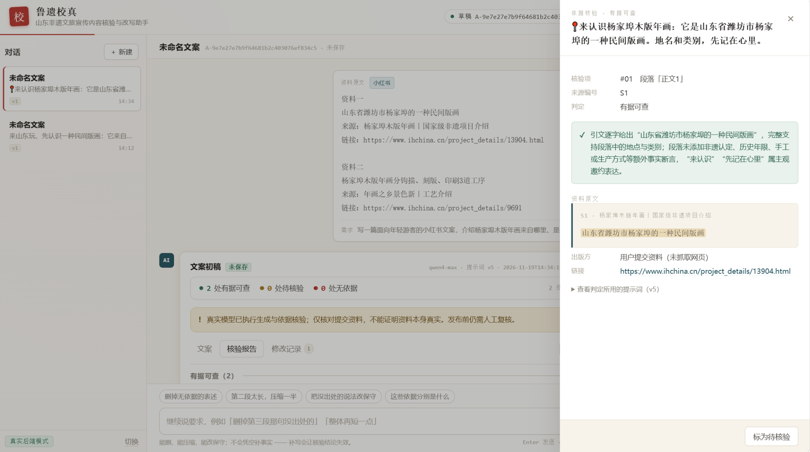
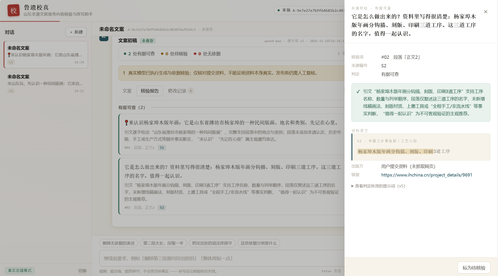
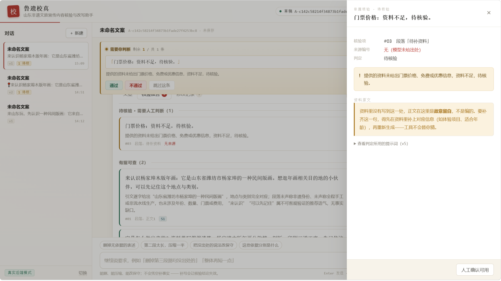

# B 真实模型网页验收记录

2026 年 11 月 19 日，B 在 Windows 本机使用真实模型完成杨家埠木版年画普通案例和缺票价案例的网页验收。两例均完成生成、查看依据、人工修改保存、下载最新 TXT 和同库重启读取。缺票价案例始终保留“资料不足，待核验”，没有将具体票价或免费入园写成事实。

本记录覆盖这两次固定输入及其保存、读取、导出结果，不代表所有输入均已通过。缺票价生成请求的耗时未留存；32 ms 是其保存请求耗时。网页核验只检查提交资料对文案的支持关系，不证明资料本身真实，也没有抓取来源网页补充事实。

## 测试基线与环境

| 项目 | 实际配置或结果 |
| --- | --- |
| 测试角色 | B，本机操作与结果复验 |
| 关联交付 | PR #5，`feat/abc-ai-integration` |
| 测试代码提交 | `3534db0e44343893fbddc201adec227775457db0` |
| 后端入口 | `backend.a_ai_main:app`，127.0.0.1:8000 |
| 前端 | A 原版前端，`VITE_USE_MOCK=false`，127.0.0.1:5173，桌面宽屏 |
| 生成模型 / 核验模型 | `qwen4-max` / `qwen4-max` |
| 提示词 | `v5` |
| 兼容服务基址 | `https://trial.cn-beijing.maas.aliyuncs.com/compatible-mode/v1` |
| NO_PROXY | `127.0.0.1,localhost,trial.cn-beijing.maas.aliyuncs.com` |
| 数据库 | `D:\AI-Damoxing-ABC-Review\data\abc-b-real-review.sqlite3`，重启前后使用同一路径 |
| 总时限 | `A_AI_TIMEOUT_SECONDS=45` |
| 离线后端测试 | `88 passed, 1 warning in 6.48s`；警告为 Starlette/httpx 弃用提示 |

上述 SHA 是运行代码的测试基线。后续新增本验收文档的提交不替代这一基线。本轮没有修改业务代码。密钥只在本机后端进程环境中提供，未随记录提交。

## 统一输入

两例使用相同资料正文、来源标题和链接。标题和链接作为元数据保留，不作为非遗身份、级别或其他事实的补证。

| 来源 | 提交的原文短摘 | 原链接 |
| --- | --- | --- |
| S1 | 山东省潍坊市杨家埠的一种民间版画 | https://www.ihchina.cn/project_details/13904.html |
| S2 | 杨家埠木版年画分钩描、刻版、印刷3道工序 | https://www.ihchina.cn/project_details/9691 |

普通案例需求：写一篇面向年轻游客的小红书文案，介绍杨家埠木版年画来自哪里、是怎么做出来的。

缺票价案例在相同需求后增加：请补充门票价格；如果资料不足，请明确标记为待核验。

网页平台字段为 `xiaohongshu`。两例响应中的稳定来源编号与 S1/S2 映射、引文在正文中的位置及规范化输入摘要已核对；详细编号和摘要见 [字段摘要](acceptance/b-real/acceptance-summary.json)。

## 两例实际结果

| 项目 | 普通案例 | 缺票价案例 |
| --- | --- | --- |
| 草稿编号 | `A-9e7e27e7b9f64681b2c403076ef834c5` | `A-c142c58214f34873b1fade27f4253bc8` |
| 生成时间（北京时间） | 2026-11-19 22:34:15 | 2026-11-19 23:09:55 |
| 浏览器生成请求耗时 | 13.03 秒 | 未留存 |
| 真实调用相关响应字段 | `mode=real`、`data_origin=ai`、`ai_meta.mode=live` | 同左 |
| 初稿状态 | P1、P2 均 `verified` | P1、P2 为 `verified`；票价 `pending_0` 为 `needs_check` |
| 查看依据 | P1/S1、P2/S2 可显示引文、判定及原因 | 票价显示待核验、无来源及资料缺失原因 |
| 人工修改 | 仅修改 P1 的推荐语句 | 仅修改 P1 的推荐语句，保留票价待核验段 |
| 保存 | HTTP 200，v2，`changed_segments=["P1"]` | HTTP 200，32 ms，v2，`changed_segments=["P1"]` |
| 保存后回读 | 同一草稿 v2，修改保留，P1 待复核、P2 有依据 | 同一草稿 v2，修改保留，P1 待复核、P2 有依据、票价仍待核验；GET 200 |
| 服务端导出 | HTTP 200，TXT v2 | HTTP 200，TXT v2 |
| 实际下载文件 | 新句存在、旧句已替换，含人工修改后待复核标记 | 新句存在、旧句已替换，含人工修改后待复核及票价待核验标记 |
| 同库重启后读取 | GET 200，仍为 v2，正文、状态、历史和模型元数据保留 | GET 200，仍为 v2，正文、状态、历史和模型元数据保留，票价仍待核验 |

生成成功响应已由 B 提交并核对。生成请求本身的 HTTP 状态没有单独留存截图或 HAR，本记录不将后续保存、读取或导出的 200 当作其独立网络证据。读取和导出的 200 由 B 根据浏览器网络面板报告。

真实调用的验收依据为：本机配置真实模型服务后运行 AI 入口、成功请求返回新草稿及生成/核验元数据，并完成后续保存、导出和重启读取；不是仅凭一个 `mode` 字段判断。未附服务商侧请求日志或账单，不推算真实调用次数、重试次数或 token 用量。

### 普通案例：修改及持久化

将 P1 中“地名和类别，先记在心里。”替换为“我想进一步了解杨家埠木版年画。”，地点与类别原句保持不变。

保存时间为 `2026-11-19T14:51:53.132931+00:00`（北京时间 22:51:53）。回读及重启后的响应均保留 v2 和新句。P1 的 `review_status=edited_needs_review`，当前 claim 为 `needs_check`，`cite_ids`、`quotes` 均为空；旧依据留在历史，不继续充当修改后正文的当前依据。P2 仍为 `verified`，引用 S2。

人工历史包含修改前后内容；`ai_meta` 保留原生成时间、模型和输入摘要。保存不代表重新运行 AI 核验。

初稿依据截图：

### 缺票价案例：资料不足及持久化

初稿单独返回“门票价格：资料不足，待核验。”，状态为 `needs_check`，来源编号和引文数组为空。原因明确说明给定资料未提供门票价格、免费或优惠信息。正文没有具体票价或免费入园断言。

将 P1 的推荐语句替换为“出发前，我会先核实门票信息。”，保留原地点、类别与票价待核验段。保存时间为 `2026-11-19T15:21:43.521161+00:00`（北京时间 23:21:43）。保存、刷新读取、导出和同库重启读取均保留新句及票价待核验提示。

修改后，P1 为人工修改后待复核、P2 仍有依据、票价仍待核验，合计一处 `verified`、两处 `needs_check`。票价没有因人工修改其他段落而获得引用或变为有依据。

## 实际 TXT 核对

实际下载的两份 TXT 均带 UTF-8 BOM。去除编码标记后，文件全文分别与服务端 export 响应的 `content` 逐字一致。两份文件均为 v2，保留修改后的句子；缺票价文件同时保留“【待核验】门票价格：资料不足，待核验。”。

| 文件 | 字节数 | SHA-256（含 BOM 的原文件） |
| --- | --- | --- |
| [普通案例 v2 TXT](acceptance/b-real/A-9e7e27e7b9f64681b2c403076ef834c5_v2.txt) | 522 | `6bf9b0a0627be812001686bd4eaad13114f767958de3fe541c01a0c22d21ca2f` |
| [缺票价案例 v2 TXT](acceptance/b-real/A-c142c58214f34873b1fade27f4253bc8_v2.txt) | 593 | `a459b7b99b6f2fba269920ad2f5040c43da6bd1e01107e421f746528f9be59b7` |

核对同时包含服务端 export 成功响应和实际文件内容，未将前端本地导出兜底单独视为服务端导出成功。

## 已解决的本机配置问题

初次请求曾返回 502，内部探测为上游 HTTP 400。进一步检查发现本机环境中的 Key 仅有一个字符且含控制字符；重新输入完整 Key 后，独立模块和网页生成成功。本轮未修改业务代码。

本轮成功配置使用上述 trial 基址及 NO_PROXY。修正 Key 后未对此前的 dashscope 基址重新测试，因此不能据此断言旧基址不可用，或把问题单独归因于代理、服务地区或模型名称。

## 保留的边界与问题

| 项目 | 本轮结论 |
| --- | --- |
| 追问/多轮改写 | 沿用 C 的已知限制：501，本轮没有重新验收该功能 |
| 430×932 窄屏新建资料表单 | 沿用 C 的已知问题，本轮使用桌面宽屏，没有宣称窄屏修复 |
| 保存后的核验状态刷新 | A 保存回执不立即刷新 claims；本轮通过刷新并重新打开草稿检查服务端状态 |
| 来源查看入口 | S1/S2 标签打开来源原文；点击核验报告卡片正文才能看到判定与原因，两种视图用途不同 |
| 历史说明措辞 | 缺票价初稿的历史说明出现“共3段、3处事实性表述已完成来源核对”，容易被理解为三处都有依据；实际初稿为2处有依据、1处待核验。建议后续明确分别显示数量，并避免把模型“承诺”写成真实性保证。当前段落状态、核验报告和 TXT 的不足提示正确，本轮记录为非阻断措辞问题 |
| 时延记录 | 普通生成为13.03秒；缺票价生成耗时未留存，不能用32 ms保存耗时补齐，也不推断平均时延 |

历史措辞问题复现：使用本记录的相同资料和缺票价需求生成，保存后回读草稿，查看 `history` 中标题为“AI 生成初稿”的 `desc`，并与 `segments` 中的实际状态比较。

## 证据范围

本次整理的附件包含：三张界面核验截图、两份实际下载的 TXT、根据 B 提交响应以 UTF-8 排版整理的两份保存回执和两份 export 响应，以及 [验收字段摘要](acceptance/b-real/acceptance-summary.json)。JSON 排版整理不新增或推断接口返回值。

B 本机保存的完整生成、刷新和重启回读响应可继续保留在同一证据目录，文件名分别为 `normal.generate.json`、`normal.reload.json`、`normal.after-restart.json`、`missing_price.generate.json`、`missing_price.reload.json`、`missing_price.after-restart.json`。这些完整文件未包含在本次整理附件中，不能把字段摘要当成原始网络录制。本次判断依据为 B 在本轮会话实际提交的完整响应及附件。

本记录新增真实验收结果，不覆盖 C 原有的离线回放记录。未留存的数据明确记为未留存；已知限制按实际范围保留。
